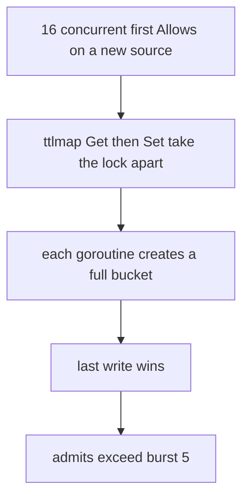

## Motivation
Traefik confirma una carrera en las primeras peticiones concurrentes de una fuente nueva: `Get` y `Set` del `ttlmap` toman el lock por separado, cada goroutine crea un cubo lleno y la última escritura gana. El informe está en https://github.com/traefik/traefik/issues/14328 (primera mención en https://github.com/traefik/traefik/issues/13957). En el repro upstream, 18 de 20 rondas superan `burst = 5` (hasta 13 de 16 admitidas).

Ese defecto upstream no ocurre aquí: `Memory` sostiene un mutex único durante lookup, create y consume; `Redis` admite con un `Eval` atómico de `allowScript`. El hueco era de prueba, no de producto: el contrato vivo no nombraba 16 primeras peticiones simultáneas contra burst, y el paquete no tenía un test concurrente de primeras peticiones.

Sin esa prueba, un cambio futuro en el almacén en proceso o en el script Lua podría reabrir la ventana Get/Set y el CI no lo vería. El coste de dejarlo es un hueco de regresión, no un fallo de producto hoy.

Priority: P3 — tests y spec cubren un hueco de prueba, sin daño actual a operadores ni usuarios

## Implementation
Este ticket es solo tests. No reescribe el limitador: `Memory.Allow`, `Redis.Allow` y `allowScript` quedan como en dest.

La prueba es `TestTraefik14328_MemoryConcurrentFirstRequests` (20 rondas, un `NewMemory` nuevo por ronda, clave opaca `192.0.2.1`) y `TestTraefik14328_RedisConcurrentFirstRequests` (10 rondas contra Redis y Dragonfly vivos, una clave nueva por ronda). Ambos lanzan 16 goroutines en una barrera compartida (`ready` WaitGroup, `close(start)`), llaman `Allow` a 1 req/min, burst 5, maxDelay 500 ms, ttl 120 s, cuentan `Status.Allowed` y fallan si admits > burst o si `Allow` devuelve error.

El cliente vivo usa `waitLiveClient14328` local (`PoolSize` 16, `MaxIdleConns` 16, `PoolTimeout` 2 s) para que las 16 primeras peticiones puedan solaparse, y reutiliza `runForEachLiveEngine` para skip/`-short`. Los helpers quedan en los archivos del issue con sufijo `14328`. Los deltas de spec pliegan el mismo escenario en `std_go_tokenbucket_allow` y `std_go_tokenbucket_lua-eval`.

## What this changes
**Operators.** None.
**Admin users.** None.
**Developers.** El contrato vivo ahora exige que 16 `Allow` simultáneos de una clave nueva admitan como máximo burst, cubierto por los tests de Memory y de Redis/Dragonfly.
**End users.** None.

## Merge readiness
Ready for review. 0 items remain.

Priority: P3 — tests y spec cubren un hueco de prueba, sin daño actual a operadores ni usuarios
Reviewed head: ceb2f501
Owner decision: None.

## Review scores
| Measure | Result | What it means |
| --- | --- | --- |
| Overall readiness | 6/6 | Ready |
| CI proof | 6/6 | succeeded https://github.com/david-garcia-garcia/traefik-middleware-utilities/actions/runs/44996996190 |
| Local tests proof | N/A | remote PR — CI proof covers this |
| Review resolution | 6/6 | no open PR comments |

## Verification
| Check | Result | Evidence |
| --- | --- | --- |
| Branch | 2026-11-22-tokenbucket-concurrent-first-requests pushed | `git` |
| OpenSpec | tokenbucket-concurrent-first-requests | `openspec/` |
| Pull request | https://github.com/david-garcia-garcia/traefik-middleware-utilities/pull/110 | pr-host |
| CI | build 44996996190 succeeded https://github.com/david-garcia-garcia/traefik-middleware-utilities/actions/runs/44996996190 | https://github.com/david-garcia-garcia/traefik-middleware-utilities/actions/runs/44996996190 |
| Local tests | passed | handoff.yaml localTests |
| PR comments | no comments | devstate/comments.md |

## Specs
Worktree:
- [std_go_tokenbucket_allow](https://github.com/david-garcia-garcia/traefik-middleware-utilities/blob/2026-11-22-tokenbucket-concurrent-first-requests/openspec/changes/archive/2026-11-22-tokenbucket-concurrent-first-requests/proposal.md) — modified
- [std_go_tokenbucket_lua-eval](https://github.com/david-garcia-garcia/traefik-middleware-utilities/blob/2026-11-22-tokenbucket-concurrent-first-requests/openspec/changes/archive/2026-11-22-tokenbucket-concurrent-first-requests/proposal.md) — modified

Completed:
- [std_go_tokenbucket_allow](https://github.com/david-garcia-garcia/traefik-middleware-utilities/blob/2026-11-22-tokenbucket-concurrent-first-requests/openspec/specs/std_go_tokenbucket_allow/spec.md) — modified
- [std_go_tokenbucket_lua-eval](https://github.com/david-garcia-garcia/traefik-middleware-utilities/blob/2026-11-22-tokenbucket-concurrent-first-requests/openspec/specs/std_go_tokenbucket_lua-eval/spec.md) — modified

## Deviations from the ask
- taken: misma puerta que `TestLive_Limiter` vía `runForEachLiveEngine` / `waitLiveClient`, y PoolSize 16 para que las 16 peticiones se solapen. → `runForEachLiveEngine` para skip y tabla Redis/Dragonfly; `simpleredis.New` en `traefik_issue14328_e2e_test.go` con PoolSize 16, MaxIdleConns 16, PoolTimeout 2s, más espera local `waitLiveClient14328`. — `tokenbucket/limiter_e2e_test.go (waitLiveClient)` — honrar las dos letras a la vez añade un parámetro PoolSize a `waitLiveClient`, un helper cuyo trabajo es esperar con Config por defecto (PoolSize 8). Out of scope prohíbe helpers compartidos; el repro 14328 ya construye el cliente con PoolSize 16.. Requester: not asked.

## Follow-up issues
None.

## How this fits together
Ticket 2026-11-22-tokenbucket-concurrent-first-requests on branch 2026-11-22-tokenbucket-concurrent-first-requests targeting master; PR https://github.com/david-garcia-garcia/traefik-middleware-utilities/pull/110; CI build 44996996190 succeeded https://github.com/david-garcia-garcia/traefik-middleware-utilities/actions/runs/44996996190.

## Explore Decisions
None.

## Findings
None.

## Axis review
[Standards](https://github.com/david-garcia-garcia/traefik-middleware-utilities/blob/2026-11-22-tokenbucket-concurrent-first-requests/devstate/2026/11/2026-11-22-tokenbucket-concurrent-first-requests/codereview_standards.md) — 0 total, 0 pending, 0 completed
[Nitpicks](https://github.com/david-garcia-garcia/traefik-middleware-utilities/blob/2026-11-22-tokenbucket-concurrent-first-requests/devstate/2026/11/2026-11-22-tokenbucket-concurrent-first-requests/codereview_nitpicks.md) — 0 total, 0 pending, 0 completed
[Spec](https://github.com/david-garcia-garcia/traefik-middleware-utilities/blob/2026-11-22-tokenbucket-concurrent-first-requests/devstate/2026/11/2026-11-22-tokenbucket-concurrent-first-requests/codereview_spec.md) — 0 total, 0 pending, 0 completed
[Scope](https://github.com/david-garcia-garcia/traefik-middleware-utilities/blob/2026-11-22-tokenbucket-concurrent-first-requests/devstate/2026/11/2026-11-22-tokenbucket-concurrent-first-requests/codereview_scope.md) — 0 total, 0 pending, 0 completed
[Security](https://github.com/david-garcia-garcia/traefik-middleware-utilities/blob/2026-11-22-tokenbucket-concurrent-first-requests/devstate/2026/11/2026-11-22-tokenbucket-concurrent-first-requests/codereview_security.md) — 0 total, 0 pending, 0 completed
[Performance](https://github.com/david-garcia-garcia/traefik-middleware-utilities/blob/2026-11-22-tokenbucket-concurrent-first-requests/devstate/2026/11/2026-11-22-tokenbucket-concurrent-first-requests/codereview_performance.md) — 0 total, 0 pending, 0 completed
[Dead](https://github.com/david-garcia-garcia/traefik-middleware-utilities/blob/2026-11-22-tokenbucket-concurrent-first-requests/devstate/2026/11/2026-11-22-tokenbucket-concurrent-first-requests/codereview_dead.md) — 0 total, 0 pending, 0 completed
[Test coverage](https://github.com/david-garcia-garcia/traefik-middleware-utilities/blob/2026-11-22-tokenbucket-concurrent-first-requests/devstate/2026/11/2026-11-22-tokenbucket-concurrent-first-requests/codereview_coverage.md) — 0 total, 0 pending, 0 completed

## Agent review details

### Review metrics
| Metric | Value | Why it matters |
| --- | --- | --- |
| Specs in this PR | 0 added / 4 modified | Same list as ## Specs |
| Open reviewer comments walked | 0 FIX / 0 ANSWER / 0 open | Unanswered review is merge risk |
| Reviewed head | ceb2f5011a7b8e4cbf771a5fc784284e6ae0c019 | Card must match the branch you measured |

### Stored data model
None.
