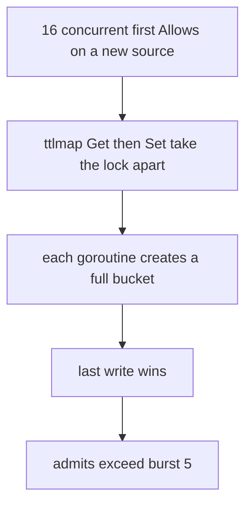

# Delivery

## Motivation

Traefik confirma una carrera en las primeras peticiones concurrentes de una fuente nueva: `Get` y `Set` del `ttlmap` toman el lock por separado, cada goroutine crea un cubo lleno y la última escritura gana. El informe está en https://github.com/traefik/traefik/issues/14328 (primera mención en https://github.com/traefik/traefik/issues/13957). En el repro upstream, 18 de 20 rondas superan `burst = 5` (hasta 13 de 16 admitidas).

Ese defecto upstream no ocurre aquí: `Memory` sostiene un mutex único durante lookup, create y consume; `Redis` admite con un `Eval` atómico de `allowScript`. El hueco era de prueba, no de producto: el contrato vivo no nombraba 16 primeras peticiones simultáneas contra burst, y el paquete no tenía un test concurrente de primeras peticiones.

Sin esa prueba, un cambio futuro en el almacén en proceso o en el script Lua podría reabrir la ventana Get/Set y el CI no lo vería. El coste de dejarlo es un hueco de regresión, no un fallo de producto hoy.

Priority: P3 — tests y spec cubren un hueco de prueba, sin daño actual a operadores ni usuarios

## Implementation

Este ticket es solo tests. No reescribe el limitador: `Memory.Allow`, `Redis.Allow` y `allowScript` quedan como en dest.

La prueba es `TestTraefik14328_MemoryConcurrentFirstRequests` (20 rondas, un `NewMemory` nuevo por ronda, clave opaca `192.0.2.1`) y `TestTraefik14328_RedisConcurrentFirstRequests` (10 rondas contra Redis y Dragonfly vivos, una clave nueva por ronda). Ambos lanzan 16 goroutines en una barrera compartida (`ready` WaitGroup, `close(start)`), llaman `Allow` a 1 req/min, burst 5, maxDelay 500 ms, ttl 120 s, cuentan `Status.Allowed` y fallan si admits > burst o si `Allow` devuelve error.

El cliente vivo usa `waitLiveClient14328` local (`PoolSize` 16, `MaxIdleConns` 16, `PoolTimeout` 2 s) para que las 16 primeras peticiones puedan solaparse, y reutiliza `runForEachLiveEngine` para skip/`-short`. Los helpers quedan en los archivos del issue con sufijo `14328`. Los deltas de spec pliegan el mismo escenario en `std_go_tokenbucket_allow` y `std_go_tokenbucket_lua-eval`.

## What this changes
**Operators.** None.
**Admin users.** None.
**Developers.** El contrato vivo ahora exige que 16 `Allow` simultáneos de una clave nueva admitan como máximo burst, cubierto por los tests de Memory y de Redis/Dragonfly.
**End users.** None.
