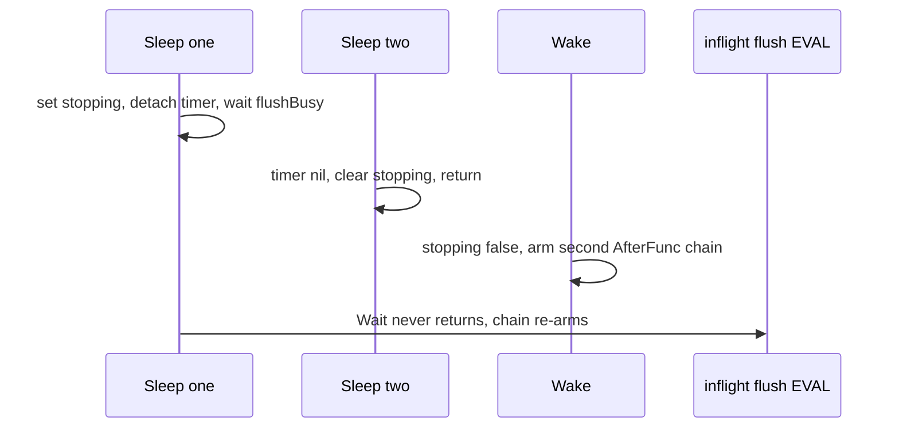

## Motivation
`Sleep` on a buffered limiter flushes pending deltas then parks the AfterFunc flush timer. `stopFlushAndWait` sets a single `stopping` bool, detaches `flushTimer`, and waits on `flushBusy` for the in-flight tick. `Wake` refuses to arm while `stopping` is true. The live contract already covers one `Sleep` versus a concurrent `Wake`. Several owners can share one `Limiter` (the README `reclaim.Hooks` pattern) and call `Sleep` at the same time. Reclaim last-holder Sleep is serialized per key, so that path does not hit this hole.

Sleep one sets `stopping` true, copies the timer, sets `flushTimer` to nil, and waits on `flushBusy` while a flush EVAL is in flight. A concurrent Sleep two finds `flushTimer` already nil, sets `stopping` false, and returns at once. That caller treats pending hits as flushed while the EVAL is still held. A `Wake` in that gap sees `stopping` false and `flushTimer` nil, starts a second AfterFunc chain, and Sleep one's `flushBusy.Wait()` then waits on a chain that re-arms forever, so Sleep one never returns. A hung Sleep can keep a reclaim key busy, so later Opens on that key block.

Left alone, concurrent `Sleep` on a shared `Limiter` can return a false flush-complete, hang the other Sleep, and stall later Opens on that key. The blast radius is that sharing path, not the serialized last-holder Sleep.

Priority: P2 — hang and false flush-complete on concurrent Sleep, limited blast radius

## Implementation
`stopFlushAndWait` counts callers instead of a bool. Each caller increments `stoppers`, detaches `flushTimer` if one is stored, waits on `flushBusy` even when the timer was already nil, then decrements. `Wake` and `flushAfterTick` arm only while `stoppers` is zero, so a Wake during any pending stop starts nothing and at most one AfterFunc chain exists afterwards. The AfterFunc flush model is unchanged.

Black-box tests hold the next flush EVAL: two concurrent Sleeps wait until release and both return after, a Wake during those waits arms nothing and a later Wake then Sleep arms and stops one chain, and the existing one-Sleep-versus-Wake control still returns.

## What this changes
**Operators.** None.
**Admin users.** None.
**Developers.** Concurrent `Sleep` on one `Limiter` each wait for the in-flight flush, and `Wake` does not arm while any Sleep is still waiting.
**End users.** None.

## Merge readiness
Ready for review. 0 items remain.

Priority: P2 — hang and false flush-complete on concurrent Sleep, limited blast radius
Reviewed head: c2c1a2f4
Owner decision: None.

## Review scores
| Measure | Result | What it means |
| --- | --- | --- |
| Overall readiness | 6/6 | Ready |
| CI proof | 6/6 | succeeded https://github.com/david-garcia-garcia/traefik-middleware-utilities/actions/runs/45013794409 |
| Local tests proof | N/A | remote PR — CI proof covers this |
| Review resolution | 6/6 | no open PR comments |

## Verification
| Check | Result | Evidence |
| --- | --- | --- |
| Branch | 2026-11-22-windowcounter-concurrent-sleep pushed | `git` |
| OpenSpec | windowcounter-concurrent-sleep-stop | `openspec/` |
| Pull request | https://github.com/david-garcia-garcia/traefik-middleware-utilities/pull/125 | pr-host |
| CI | build 45013794409 succeeded https://github.com/david-garcia-garcia/traefik-middleware-utilities/actions/runs/45013794409 | https://github.com/david-garcia-garcia/traefik-middleware-utilities/actions/runs/45013794409 |
| Local tests | passed | handoff.yaml localTests |
| PR comments | no comments | devstate/comments.md |

## Specs
Worktree:
- [std_go_windowcounter_sync-flush](https://github.com/david-garcia-garcia/traefik-middleware-utilities/blob/2026-11-22-windowcounter-concurrent-sleep/openspec/changes/archive/2026-11-22-windowcounter-concurrent-sleep-stop/proposal.md) — modified

Completed:
- [std_go_windowcounter_sync-flush](https://github.com/david-garcia-garcia/traefik-middleware-utilities/blob/2026-11-22-windowcounter-concurrent-sleep/openspec/specs/std_go_windowcounter_sync-flush/spec.md) — modified

## Deviations from the ask
None.

## Follow-up issues
None.

## How this fits together
Ticket 2026-11-22-windowcounter-concurrent-sleep on branch 2026-11-22-windowcounter-concurrent-sleep targeting master; PR https://github.com/david-garcia-garcia/traefik-middleware-utilities/pull/125; CI build 45013794409 succeeded https://github.com/david-garcia-garcia/traefik-middleware-utilities/actions/runs/45013794409.

## Explore Decisions
None.

## Findings
None.

## Axis review
[Standards](https://github.com/david-garcia-garcia/traefik-middleware-utilities/blob/2026-11-22-windowcounter-concurrent-sleep/devstate/2026/11/2026-11-22-windowcounter-concurrent-sleep/codereview_standards.md) — 0 total, 0 pending, 0 completed
[Nitpicks](https://github.com/david-garcia-garcia/traefik-middleware-utilities/blob/2026-11-22-windowcounter-concurrent-sleep/devstate/2026/11/2026-11-22-windowcounter-concurrent-sleep/codereview_nitpicks.md) — 0 total, 0 pending, 0 completed
[Spec](https://github.com/david-garcia-garcia/traefik-middleware-utilities/blob/2026-11-22-windowcounter-concurrent-sleep/devstate/2026/11/2026-11-22-windowcounter-concurrent-sleep/codereview_spec.md) — 0 total, 0 pending, 0 completed
[Scope](https://github.com/david-garcia-garcia/traefik-middleware-utilities/blob/2026-11-22-windowcounter-concurrent-sleep/devstate/2026/11/2026-11-22-windowcounter-concurrent-sleep/codereview_scope.md) — 0 total, 0 pending, 0 completed
[Security](https://github.com/david-garcia-garcia/traefik-middleware-utilities/blob/2026-11-22-windowcounter-concurrent-sleep/devstate/2026/11/2026-11-22-windowcounter-concurrent-sleep/codereview_security.md) — 0 total, 0 pending, 0 completed
[Performance](https://github.com/david-garcia-garcia/traefik-middleware-utilities/blob/2026-11-22-windowcounter-concurrent-sleep/devstate/2026/11/2026-11-22-windowcounter-concurrent-sleep/codereview_performance.md) — 0 total, 0 pending, 0 completed
[Dead](https://github.com/david-garcia-garcia/traefik-middleware-utilities/blob/2026-11-22-windowcounter-concurrent-sleep/devstate/2026/11/2026-11-22-windowcounter-concurrent-sleep/codereview_dead.md) — 0 total, 0 pending, 0 completed
[Test coverage](https://github.com/david-garcia-garcia/traefik-middleware-utilities/blob/2026-11-22-windowcounter-concurrent-sleep/devstate/2026/11/2026-11-22-windowcounter-concurrent-sleep/codereview_coverage.md) — 0 total, 0 pending, 0 completed

## Agent review details

### Review metrics
| Metric | Value | Why it matters |
| --- | --- | --- |
| Specs in this PR | 0 added / 2 modified | Same list as ## Specs |
| Open reviewer comments walked | 0 FIX / 0 ANSWER / 0 open | Unanswered review is merge risk |
| Reviewed head | c2c1a2f421190480e792af6ea6faadc3f67a684a | Card must match the branch you measured |

### Stored data model
None.
