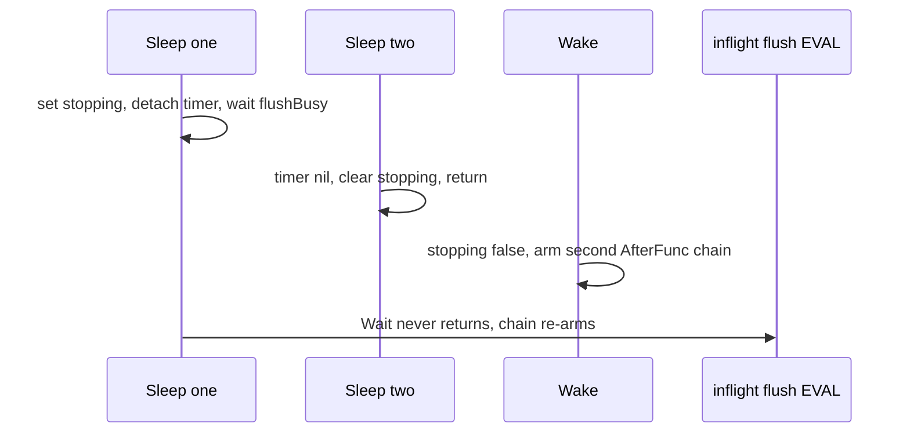

# Delivery

## Motivation

`Sleep` on a buffered limiter flushes pending deltas then parks the AfterFunc flush timer. `stopFlushAndWait` sets a single `stopping` bool, detaches `flushTimer`, and waits on `flushBusy` for the in-flight tick. `Wake` refuses to arm while `stopping` is true. The live contract already covers one `Sleep` versus a concurrent `Wake`. Several owners can share one `Limiter` (the README `reclaim.Hooks` pattern) and call `Sleep` at the same time. Reclaim last-holder Sleep is serialized per key, so that path does not hit this hole.

Sleep one sets `stopping` true, copies the timer, sets `flushTimer` to nil, and waits on `flushBusy` while a flush EVAL is in flight. A concurrent Sleep two finds `flushTimer` already nil, sets `stopping` false, and returns at once. That caller treats pending hits as flushed while the EVAL is still held. A `Wake` in that gap sees `stopping` false and `flushTimer` nil, starts a second AfterFunc chain, and Sleep one's `flushBusy.Wait()` then waits on a chain that re-arms forever, so Sleep one never returns. A hung Sleep can keep a reclaim key busy, so later Opens on that key block.

Left alone, concurrent `Sleep` on a shared `Limiter` can return a false flush-complete, hang the other Sleep, and stall later Opens on that key. The blast radius is that sharing path, not the serialized last-holder Sleep.

Priority: P2 — hang and false flush-complete on concurrent Sleep, limited blast radius

## Implementation

`stopFlushAndWait` counts callers instead of a bool. Each caller increments `stoppers`, detaches `flushTimer` if one is stored, waits on `flushBusy` even when the timer was already nil, then decrements. `Wake` and `flushAfterTick` arm only while `stoppers` is zero, so a Wake during any pending stop starts nothing and at most one AfterFunc chain exists afterwards. The AfterFunc flush model is unchanged.

Black-box tests hold the next flush EVAL: two concurrent Sleeps wait until release and both return after, a Wake during those waits arms nothing and a later Wake then Sleep arms and stops one chain, and the existing one-Sleep-versus-Wake control still returns.

## What this changes
**Operators.** None.
**Admin users.** None.
**Developers.** Concurrent `Sleep` on one `Limiter` each wait for the in-flight flush, and `Wake` does not arm while any Sleep is still waiting.
**End users.** None.
